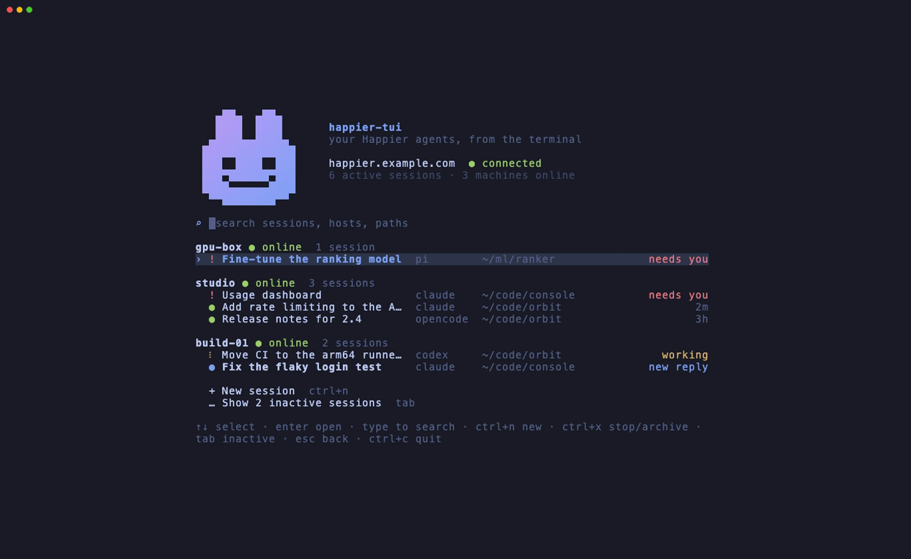
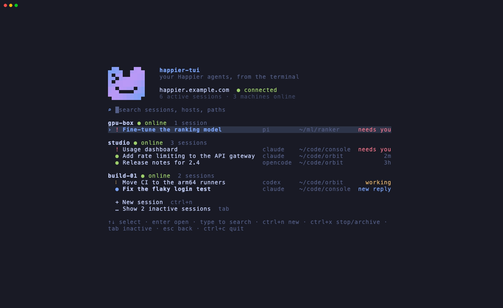
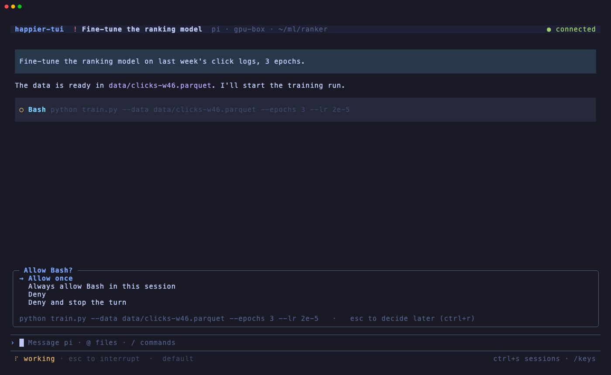

# happier-tui

Drive your [Happier](https://github.com/happier-dev/happier) coding agents from a terminal.

Pick a session running on any of your machines, read it live, send prompts, answer permission
requests, start new sessions — and get a bell or a notification from your terminal, tmux or cmux
when an agent needs you.



happier-tui is an independent, unofficial client. It talks to the Happier relay directly (HTTP and
Socket.IO, end-to-end encrypted) and is built on
[`@earendil-works/pi-tui`](https://www.npmjs.com/package/@earendil-works/pi-tui), the library
behind Pi's terminal UI.

## Install

You need two things on the machine first:

- **Node.js 22.19 or newer**, 24 LTS recommended — check with `node --version`; install with `brew install node` on macOS
  or from [nodejs.org](https://nodejs.org).
- **The Happier CLI, logged in** — `happier auth login`. happier-tui reuses the credentials the CLI
  stores under `~/.happier`; it has no login of its own.

Then:

```bash
npm install -g happier-tui
```

Run `happier-tui`. To update: run the same command again. To remove it:
`npm uninstall -g happier-tui`.

### From source

```bash
git clone https://github.com/CyrilPeponnet/happier-tui.git
cd happier-tui
npm install        # downloads dependencies
npm run build
npm install -g .   # links the `happier-tui` command to this folder
```

To update: `git pull && npm install && npm run build` in the same folder. Without installing a command, run
`node dist/main.js` from the folder.

## Use

```
happier-tui                          start screen: pick or start a session
happier-tui <session-id-or-prefix>   open a session directly (or --session <id>)
happier-tui <directory>              start a new session on this machine in that directory
happier-tui --list [--all]           print active (or all) sessions and exit

  --agent <name>          agent for the new session (claude, codex, pi, …); asked for otherwise
  --resume <id>           continue that conversation of the agent (its own session id), with
                          a directory and --agent
  --server <id-or-name>   server profile from ~/.happier/settings.json
  --server-url <url>      override the relay URL
  --home <dir>            Happier home (default ~/.happier, or $HAPPIER_HOME_DIR)
  --no-bell               notify without ringing the terminal bell
  --no-notify             no attention signal at all
```

### Start screen

Active sessions grouped by machine, each with its agent, folder and last activity, or what it
is doing: `working`, `needs you` (a permission request or a question) or `new reply` (not seen
yet). Type to search by title, host, agent or path.

For Claude, Codex and pi, a new session can also continue one of the agent's earlier
conversations in that directory, including ones started outside Happier (a plain `pi` or
`claude` in a terminal): after the directory, pick one from the list, newest first. One that a
Happier session already continues opens that session instead.



| Key | Action |
| --- | --- |
| `↑` `↓`, `enter` | select, open |
| `ctrl+n` | new session: machine → agent → directory, then new or an earlier conversation |
| `ctrl+x` | stop the selected session's agent, archive the session, or both |
| `tab` | show or hide inactive sessions |
| `esc` | clear the search, then go back to the open session |

### In a session

| Key | Action |
| --- | --- |
| `enter` / `shift+enter` | send / newline |
| `esc` | interrupt the agent's current turn |
| `ctrl+s` | back to the start screen |
| `alt+↑` / `alt+↓` | previous / next active session |
| `ctrl+r` | answer a pending permission request, agent question or offered choices |
| `ctrl+o` / `ctrl+t` | expand tool calls and their output / show or hide thinking |
| `pgup` / `pgdn`, mouse wheel | scroll; reaching the top loads earlier history |
| `ctrl+shift+f` | search the transcript |
| `ctrl+c` twice, `ctrl+d` | quit |

Type `@` to mention a file: completion lists the files of the session's folder on its machine
(through the daemon's ripgrep, so `.gitignore` applies).

| Command | |
| --- | --- |
| `/model`, `/effort` | change the model, and its thinking level when it has one |
| `/mode` | the agent's own modes (when it reports any) and the permission mode |
| `/queue` | edit or cancel messages still waiting to be sent |
| `/tree` | branch into a new session from an earlier message, which is put back in the editor to rewrite (Codex sessions can also roll back in place) |
| `/goal [text\|clear]` | show, set or clear the session's goal (Claude, Codex) |
| `/usage` | context and plan limits, with when they reset; after a usage limit, resume automatically when it resets, or check now |
| `/rename` | rename the session |
| `/sessions`, `/new-session`, `/abort`, `/stop-session`, `/archive`, `/reload`, `/keys`, `/quit` | |

When the agent ends its turn offering choices, the first one is highlighted in the transcript:
`↑` `↓` move the highlight and `enter` sends it as your reply. Typing writes your own reply
instead; `esc` puts the highlight away (`ctrl+r` brings it back). You can also click a choice.
Permission requests and questions open a picker above the editor, which closes by itself once
the request is answered elsewhere.

Anything else starting with `/` goes to the agent, whose own commands are offered in
autocomplete. The agent publishes them once it has handled a first message, so a new session
offers only the TUI's own commands until then. An agent lists only what it can run from a
message: Claude includes its built-ins (`/compact`, `/clear`, `/context`, …), while pi lists its
extensions and skills, since its other built-ins belong to its own terminal UI (the commands
above cover the model, thinking level, rename and `/tree`). `/compact` works with every agent.
Model, mode and thinking-level changes apply from your next message.

The footer shows how full the context is, and for Claude and Codex the plan limits of the
agent's account (5-hour, weekly), as rings like the Happier app's: `◔ ctx  ◑ 5h  ○ wk`, from
`○` empty to `●` full, amber from 70% and red from 90%. Click them, or type `/usage`, for the
numbers and when each limit resets. Plan limits are the ones the agent last reported with a
reply, so a session shows them after its first turn.

Above the editor, the TUI shows what needs you or is pending: permission requests and questions,
messages waiting in the queue, the session's goal and a usage-limit wait. Finished tool calls fold into one
line as the agent goes, while the one at work stays open with its latest output; a finished turn
ends with how long it took; a subagent's work shows as one line
under the tool call that started it. Click a folded line to unfold it, or a tool to see all its
output; `ctrl+o` unfolds everything.

## Knowing when an agent needs you



When the open session finishes its turn, fails, or asks for a permission or an answer while you
are not looking at it, happier-tui signals it through the terminal:

- **Bell.** Works everywhere. tmux flags the window in its status line, cmux and most terminals
  mark the tab.
- **Notification with text** (OSC 777): session name and what happened. Shown by cmux (pane ring,
  sidebar badge, banner), Ghostty, WezTerm and others; ignored by terminals that do not know it.
  Inside tmux this part needs `set -g allow-passthrough on`.

Nothing is raised while you are at the terminal looking at that session. Other sessions never
ring: they are listed in the footer, marked as on the start screen (`!` needs you, `●` new
reply), until you open them, answer their request or they start working again. So with one
happier-tui per session, as cmux or tmux tabs, each event rings only the tab showing that session.

**Phone pushes.** While you are at the terminal (it has focus and you used it in the last three
minutes), happier-tui reports a focused computer to the relay, as the Happier desktop app does.
With **Settings → Notifications → "Mute phone while a computer is focused"** enabled in the Happier
app (off by default), pushes for finished turns and permission requests are skipped while you are
there and resume when you leave or quit. The mute is account-wide, not per session. The open
session is also marked read, so the unread badge clears on your other devices.

If a signal does not show up, run with `HAPPIER_TUI_DEBUG=/tmp/happier-tui.log`. The log records
focus changes and, for each turn or request change, whether a signal was sent.

## cmux tab restore

Inside [cmux](https://cmux.com), happier-tui registers the open session as the tab's restore
command (`happier-tui --session <id>`), so the tab comes back on that session after cmux restarts.
cmux only restores tabs registered by its agent hooks, so happier-tui uses pi's: the tab shows as Pi.
Quitting normally clears the entry. The restore runs with your default server: cmux does not keep
other options such as `--server`.

## How it works

```
src/main.ts                 command line
src/app.ts                  application state, keys, layout
src/new-session.ts          the new-session wizard
src/happier/config.ts       server profile and credentials written by the Happier CLI
src/happier/crypto.ts       content encryption (AES-256-GCM data keys, legacy secretbox)
src/happier/client.ts       relay client: sessions, transcripts, prompts, RPC, realtime
src/happier/controls.ts     modes, thinking level, goal and usage limit, as kept in session metadata
src/happier/transcript.ts   decrypted records → display items (Claude, ACP, Codex formats)
src/ui/                     start screen, transcript view, picker, @ completion, logo, notifications, theme
```

- **Reading.** Sessions, transcripts and machines come over HTTP and are decrypted locally with
  per-session keys, unwrapped with the account key from the CLI's credentials.
- **Live updates.** One Socket.IO connection carries new messages, session state and streamed text.
- **Prompts** go to the relay's pending queue, where they can still be edited or cancelled until
  the agent takes them; an inactive session is resumed by its machine.
- **Model, mode, thinking level and title** are written to the session's encrypted metadata, which
  the agent reads, as the Happier app does.
- **Interrupting, answering permissions, listing files, branching, goals, usage limits and starting
  sessions** are encrypted calls relayed to the agent or to the machine's daemon.

The Happier protocol is not a published, versioned API. This client follows the Happier sources as
of CLI 0.2.20, so a relay or CLI upgrade may require changes here.

## Limits

- Direct sessions (transcript kept on the machine, not the relay) are listed but show no transcript.
- Images and attachments are neither shown nor sent.
- Of the per-model options, only the thinking level is offered.
- Plan limits come from what the agent reports; the usage of accounts connected in the Happier
  app's settings (Connected services) is not read.
- Out of scope, as the Happier app covers them: git, terminals, file browsing, moving sessions
  between machines.

## Development

```bash
npm run dev         # run from source
npm run demo        # the TUI on made-up sessions, no account needed
npm test            # unit tests
npm run typecheck
```

The README's animation and screenshots come from the demo: `npm run screenshots` (needs
[VHS](https://github.com/charmbracelet/vhs), `brew install vhs`) plays the tour in
[`scripts/screenshots.tape`](scripts/screenshots.tape) and rewrites `assets/demo.gif` and the PNGs.
Change the made-up sessions and the agent's scripted replies in [`scripts/demo.ts`](scripts/demo.ts).

### Releasing

Releases are made by GitHub Actions. Pushing a version tag runs `.github/workflows/release.yml`,
which checks that the tag matches `package.json`, runs the typecheck and tests, publishes to npm
(with provenance) and creates the GitHub release.

1. Commit and push to `main`, and check that CI is green (`gh run list`).
2. Preview the release notes: `node scripts/release-notes.mjs`. They list the commits since the
   last tag, grouped by their subject's type: `feat…:` under New, `fix…:` under Fixes, anything
   else under Other changes. Reword a subject before tagging if it reads badly.
3. Bump the version, which commits and tags it (`vX.Y.Z`):

   ```bash
   npm version patch    # fixes: 0.2.1 → 0.2.2
   npm version minor    # new features: 0.2.1 → 0.3.0
   npm version major    # breaking changes: 0.2.1 → 1.0.0
   ```

4. Push the commit and the tag; this starts the release:

   ```bash
   git push --follow-tags
   ```

   It takes a minute, and npm another minute or two to list the new version. Edit the notes
   afterwards on GitHub (or `gh release edit vX.Y.Z --notes "…"`) to add context.

If the tests fail in the release run, nothing is published: fix, then move the tag to the fixed
commit (`git tag -d vX.Y.Z && git push origin :vX.Y.Z`, then `git tag vX.Y.Z && git push --tags`).
If only the publish step failed, use "Re-run failed jobs" on the run. A version number can never be
published twice on npm; a bad release is fixed by the next one.

npm authenticates the workflow through [trusted publishing](https://docs.npmjs.com/trusted-publishers),
so there is no npm token to store: the package's settings on npmjs.com trust this repository's
`release.yml`, in the `Release` environment.

## License

[MIT](LICENSE)
