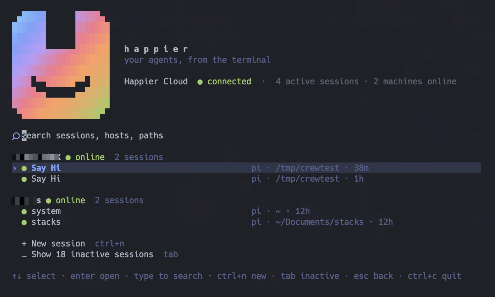

# happier-tui

Drive your [Happier](https://github.com/happier-dev/happier) coding agents from a terminal.

Pick a session running on any of your machines, read it live, send prompts, answer permission
requests, start new sessions — and get a bell or a notification from your terminal, tmux or cmux
when an agent needs you.



happier-tui is an independent, unofficial client. It talks to the Happier relay directly (HTTP and
Socket.IO, end-to-end encrypted) and is built on
[`@earendil-works/pi-tui`](https://www.npmjs.com/package/@earendil-works/pi-tui), the library
behind Pi's terminal UI.

## Install

You need two things on the machine first:

- **Node.js 20 or newer** — check with `node --version`; install with `brew install node` on macOS
  or from [nodejs.org](https://nodejs.org).
- **The Happier CLI, logged in** — `happier auth login`. happier-tui reuses the credentials the CLI
  stores under `~/.happier`; it has no login of its own.

Then:

```bash
npm install -g happier-tui
```

Run `happier-tui`. To update: run the same command again. To remove it:
`npm uninstall -g happier-tui`.

### From source

```bash
git clone https://github.com/CyrilPeponnet/happier-tui.git
cd happier-tui
npm install        # downloads dependencies and builds
npm install -g .   # adds the `happier-tui` command
```

To update: `git pull && npm install` in the same folder. Without installing a command, run
`node dist/main.js` from the folder.

## Use

```
happier-tui                          start screen: pick or start a session
happier-tui <session-id-or-prefix>   open a session directly
happier-tui --list [--all]           print active (or all) sessions and exit

  --server <id-or-name>   server profile from ~/.happier/settings.json
  --server-url <url>      override the relay URL
  --home <dir>            Happier home (default ~/.happier, or $HAPPIER_HOME_DIR)
  --no-bell               notify without ringing the terminal bell
  --no-notify             no attention signal at all
```

### Start screen

Active sessions grouped by machine. Type to search by title, host, agent or path.

| Key | Action |
| --- | --- |
| `↑` `↓`, `enter` | select, open |
| `ctrl+n` | new session: machine → agent → directory |
| `tab` | show or hide inactive sessions |
| `esc` | clear the search, then go back to the open session |

### In a session

| Key | Action |
| --- | --- |
| `enter` / `shift+enter` | send / newline |
| `esc` | interrupt the agent's current turn |
| `ctrl+s` | back to the start screen |
| `alt+↑` / `alt+↓` | previous / next active session |
| `ctrl+r` | answer a pending permission request or agent question |
| `ctrl+o` / `ctrl+t` | expand tool output / show or hide thinking |
| `pgup` / `pgdn`, mouse wheel | scroll; reaching the top loads earlier history |
| `ctrl+shift+f` | search the transcript |
| `ctrl+c` twice, `ctrl+d` | quit |

Slash commands: `/sessions`, `/new-session`, `/model`, `/mode`, `/abort`, `/stop-session`,
`/archive`, `/reload`, `/keys`, `/quit`. Anything else starting with `/` goes to the agent, whose
own commands are offered in autocomplete.

## Knowing when an agent needs you

When a session you are not looking at finishes its turn, fails, or asks for a permission or an
answer, happier-tui signals it through the terminal:

- **Bell.** Works everywhere. tmux flags the window in its status line, cmux and most terminals
  mark the tab.
- **Notification with text** (OSC 777): session name and what happened. Shown by cmux (pane ring,
  sidebar badge, banner), Ghostty, WezTerm and others; ignored by terminals that do not know it.
  Inside tmux this part needs `set -g allow-passthrough on`.

Nothing is raised for the session on screen while the terminal has focus.

**Phone pushes.** While you are at the terminal (it has focus and you used it in the last three
minutes), happier-tui reports a focused computer to the relay, as the Happier desktop app does.
With **Settings → Notifications → "Mute phone while a computer is focused"** enabled in the Happier
app (off by default), pushes for finished turns and permission requests are skipped while you are
there and resume when you leave or quit. The mute is account-wide, not per session. The open
session is also marked read, so the unread badge clears on your other devices.

If a signal does not show up, run with `HAPPIER_TUI_DEBUG=/tmp/happier-tui.log`. The log records
focus changes and, for each turn or request change, whether a signal was sent.

## How it works

```
src/main.ts                 command line
src/app.ts                  application state, keys, layout
src/new-session.ts          the new-session wizard
src/happier/config.ts       server profile and credentials written by the Happier CLI
src/happier/crypto.ts       content encryption (AES-256-GCM data keys, legacy secretbox)
src/happier/client.ts       relay client: sessions, transcripts, prompts, RPC, realtime
src/happier/transcript.ts   decrypted records → display items (Claude, ACP, Codex formats)
src/ui/                     start screen, transcript view, picker, logo, notifications, theme
```

- **Reading.** Sessions, transcripts and machines come over HTTP and are decrypted locally with
  per-session keys, unwrapped with the account key from the CLI's credentials.
- **Live updates.** One Socket.IO connection carries new messages, session state and streamed text.
- **Prompts** go to the relay's pending queue; an inactive session is resumed by its machine.
- **Interrupting, answering permissions, browsing directories and starting sessions** are encrypted
  calls relayed to the agent or to the machine's daemon.

The Happier protocol is not a published, versioned API. This client follows the Happier sources as
of CLI 0.2.20, so a relay or CLI upgrade may require changes here.

## Limits

- Direct sessions (transcript kept on the machine, not the relay) are listed but show no transcript.
- Subagent transcripts, attachments and images are not displayed.
- `/model` lists the agent's models; per-model options such as reasoning effort are not exposed.

## Development

```bash
npm run dev         # run from source
npm test            # unit tests
npm run typecheck
```

## License

[MIT](LICENSE)
